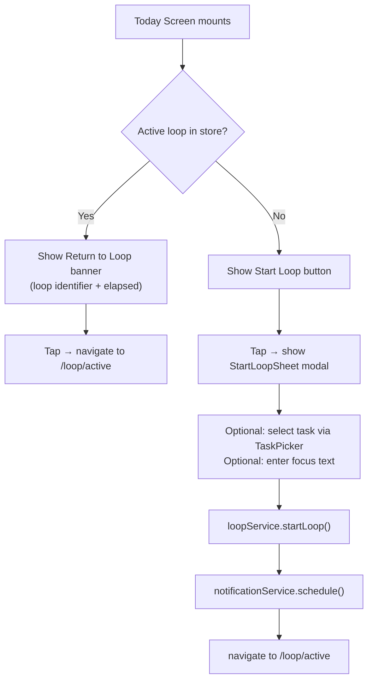
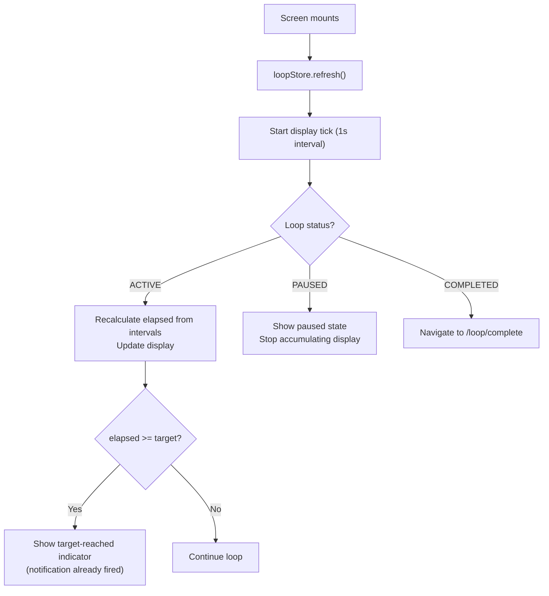
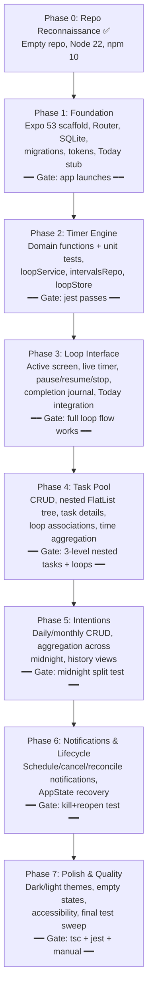

# Hour Loop — Implementation Plan

## Goal

Build **Hour Loop**, a fully offline-first cross-platform mobile application (React Native + Expo) for intentional time management. The app centres on **Loops** — timestamped focus sessions with pause/resume/stop mechanics, a lightweight completion journal, an independent hierarchical task pool, daily/monthly time intentions, and a full history view. All data lives in local SQLite; no network or account required.

---

## Reconnaissance Summary

| Item | Finding |
|---|---|
| **Repo state** | Empty directory (`/home/vasil/code/serious_projects/hour_loop`) — no existing code |
| **Git** | No history |
| **Package manager** | npm (10.9.9) — no yarn |
| **Node.js** | v22.23.4 (fully compatible) |
| **Target Expo SDK** | **SDK 53** (`53.0.27`) — most recent fully-stable SDK; ships RN 0.79, React 19, New Architecture on by default |
| **expo-sqlite** | Modern async API (`SQLiteProvider`, `useSQLiteContext`, `PRAGMA user_version` migrations) |
| **Zustand** | 5.1.0 (latest stable) |
| **Icons** | `@expo/vector-icons` 15.1.1 (includes Lucide-equivalent Feather/Ionicons set) |

> [!IMPORTANT]
> **SDK choice rationale:** SDK 53 (not 57/58) is selected because the brief specifies consulting official docs and using compatible stable releases. SDK 57/58 are either very recent or canary-stage as of this writing, while SDK 53 is fully stable, well-documented, and all required libraries (`expo-sqlite`, `expo-notifications`, `expo-router`) have known-good versions. The implementing agent must run `npx create-expo-app@latest hour_loop --template blank-typescript` and pin to `sdk-53` tag explicitly.

---

## Architecture Decision Records

### ADR-001: SQLite over Drizzle ORM
Direct typed SQL repositories are used instead of Drizzle ORM. Rationale: Drizzle adds migration tooling complexity (babel plugin, `.sql` file inlining) that is unnecessary when the schema is well-scoped, stable, and hand-tested. Versioned `PRAGMA user_version` migrations with raw parameterized SQL keep the domain layer transparent, debuggable, and free of codegen. If the schema grows substantially, Drizzle can be introduced later without touching business logic.

### ADR-002: Zustand for in-memory UI state only
Active loop state (current elapsed seconds for display, loop status) is held in a Zustand store that is derived from and always reconcilable with SQLite. Zustand is **never** the source of truth. On foreground, the store is refreshed from the DB. This guarantees crash-safety and background-process termination recovery.

### ADR-003: Timer as persisted interval log
The timer is built on `loop_intervals` rows with `started_at` / `ended_at` UTC timestamps. Elapsed seconds = sum of `(ended_at - started_at)` for closed intervals + `(now - started_at)` for the single open interval (if any). This is the **only** canonical elapsed-time calculation. The UI polls this calculation every second using `setInterval` only as a **display refresh trigger**, not as an accumulator.

### ADR-004: Expo SDK 53 + React Native New Architecture
New Architecture is on by default in SDK 53. `expo-sqlite` JSI bridge provides synchronous-ish query semantics. This is desirable for timer reads.

---

## Open Questions

> [!NOTE]
> The following items have been resolved with reasonable defaults per the brief's instruction to "select the simplest maintainable approach and record the assumption":

1. **Loop numbering reset**: Loops are numbered H1, H2, H3 per local calendar day (midnight reset). ✅ Assumption recorded.
2. **One active loop constraint**: Only one ACTIVE or PAUSED loop allowed globally at MVP. ✅
3. **Task-loop cardinality**: One loop → one optional task at MVP. Multiple loops per task is supported. ✅
4. **Roll-forward linking**: Roll forward text is stored as free text; optional task linkage uses a FK to `tasks`. ✅
5. **Theme default**: Dark mode default, respects device preference via `useColorScheme`. ✅

---

## Proposed Changes

### Project Scaffold

#### [NEW] Root `package.json` + Expo app
Created via `npx create-expo-app@latest hour_loop --template blank-typescript` then immediately upgrading to SDK 53.

**Key `package.json` dependencies:**

```json
{
  "dependencies": {
    "expo": "~53.0.0",
    "expo-router": "~4.0.0",
    "expo-sqlite": "~15.1.0",
    "expo-notifications": "~0.29.0",
    "expo-status-bar": "~2.2.0",
    "expo-device": "~7.0.0",
    "react": "19.0.0",
    "react-native": "0.79.x",
    "zustand": "^5.1.0",
    "@expo/vector-icons": "^15.1.1",
    "react-native-safe-area-context": "~5.3.0",
    "react-native-screens": "~4.10.0",
    "uuid": "^11.0.0"
  },
  "devDependencies": {
    "typescript": "~5.3.0",
    "jest": "^29.0.0",
    "jest-expo": "~53.0.0",
    "@types/react": "~19.0.0",
    "@testing-library/react-native": "^13.0.0"
  }
}
```

---

### Directory Structure

```
hour-loop/
├── app/
│   ├── _layout.tsx               ← Root layout: SQLiteProvider + NotificationHandler + ThemeProvider
│   ├── (tabs)/
│   │   ├── _layout.tsx           ← Tab navigator (Today, Tasks, History, Settings)
│   │   ├── index.tsx             ← Today screen
│   │   ├── tasks.tsx             ← Task Pool screen
│   │   ├── history.tsx           ← History screen
│   │   └── settings.tsx          ← Settings screen
│   ├── loop/
│   │   ├── active.tsx            ← Active Loop screen (full-screen focus view)
│   │   └── complete.tsx          ← Loop completion journal screen
│   └── task/
│       └── [id].tsx              ← Task Detail screen
│
├── src/
│   ├── domain/
│   │   ├── timer/
│   │   │   ├── timerEngine.ts    ← Pure functions: calculateElapsedSeconds, allocateToDay, etc.
│   │   │   └── timerEngine.test.ts
│   │   ├── tasks/
│   │   │   ├── taskDomain.ts     ← Task status derivation, cycle detection
│   │   │   └── taskDomain.test.ts
│   │   ├── intentions/
│   │   │   ├── intentionsDomain.ts
│   │   │   └── intentionsDomain.test.ts
│   │   └── shared/
│   │       └── dateUtils.ts      ← UTC/local boundary helpers, period key generation
│   │
│   ├── database/
│   │   ├── client.ts             ← openDatabaseSync, WAL, FK PRAGMA
│   │   ├── migrations.ts         ← PRAGMA user_version migrations (versioned SQL)
│   │   └── repositories/
│   │       ├── loopsRepository.ts
│   │       ├── intervalsRepository.ts
│   │       ├── tasksRepository.ts
│   │       ├── intentionsRepository.ts
│   │       └── settingsRepository.ts
│   │
│   ├── features/
│   │   ├── loops/
│   │   │   ├── loopService.ts    ← startLoop, pauseLoop, resumeLoop, completeLoop, getActiveLoop
│   │   │   └── loopService.test.ts
│   │   ├── tasks/
│   │   │   └── taskService.ts
│   │   ├── intentions/
│   │   │   └── intentionsService.ts
│   │   └── history/
│   │       └── historyService.ts
│   │
│   ├── services/
│   │   ├── notifications/
│   │   │   └── notificationService.ts ← schedule/cancel timer notifications
│   │   └── lifecycle/
│   │       └── appLifecycleService.ts ← AppState foreground recovery
│   │
│   ├── store/
│   │   ├── loopStore.ts          ← Zustand: activeLoop, elapsedSeconds (display only)
│   │   └── settingsStore.ts      ← Zustand: defaultDuration, theme
│   │
│   ├── components/
│   │   ├── common/
│   │   │   ├── Button.tsx
│   │   │   ├── ConfirmDialog.tsx
│   │   │   ├── EmptyState.tsx
│   │   │   └── LoadingScreen.tsx
│   │   ├── timer/
│   │   │   ├── TimerDisplay.tsx   ← Large HH:MM:SS display
│   │   │   ├── TimerProgress.tsx  ← Arc/bar progress against target
│   │   │   └── LoopControls.tsx   ← Pause / Resume / Stop buttons
│   │   ├── tasks/
│   │   │   ├── TaskRow.tsx
│   │   │   ├── TaskTree.tsx       ← Recursive collapsible tree (flattened for FlatList)
│   │   │   └── TaskPicker.tsx     ← Modal task selector for loop start
│   │   ├── intentions/
│   │   │   └── IntentionBar.tsx   ← Progress display for daily/monthly
│   │   └── history/
│   │       ├── LoopHistoryRow.tsx
│   │       └── DaySummary.tsx
│   │
│   ├── hooks/
│   │   ├── useActiveLoop.ts       ← Subscribes to loopStore, drives display tick
│   │   ├── useIntentions.ts
│   │   └── useTaskTree.ts
│   │
│   ├── theme/
│   │   ├── tokens.ts              ← Colors, spacing, typography, radii
│   │   ├── darkTheme.ts
│   │   ├── lightTheme.ts
│   │   └── ThemeContext.tsx
│   │
│   └── constants/
│       ├── loopStatus.ts          ← 'IDLE' | 'ACTIVE' | 'PAUSED' | 'COMPLETED'
│       └── durationPresets.ts     ← [25, 45, 60, 90] minutes
│
├── docs/
│   ├── PRODUCT_SPEC.md
│   ├── ARCHITECTURE.md
│   ├── DATABASE_SCHEMA.md
│   └── IMPLEMENTATION_PLAN.md
│
├── tests/
├── assets/
├── app.json
├── babel.config.js
├── tsconfig.json
└── jest.config.js
```

---

### Database Layer

#### [NEW] `src/database/migrations.ts`

Uses `PRAGMA user_version` for versioned migration.

```ts
export async function migrateDbIfNeeded(db: SQLiteDatabase): Promise<void> {
  await db.execAsync('PRAGMA journal_mode = WAL;');
  await db.execAsync('PRAGMA foreign_keys = ON;');

  const { user_version } = await db.getFirstAsync<{ user_version: number }>(
    'PRAGMA user_version'
  )!;
  let version = user_version ?? 0;
  const TARGET = 1;
  if (version >= TARGET) return;

  if (version < 1) {
    await db.execAsync(`
      -- tasks (must come first — loops FKs into tasks)
      CREATE TABLE tasks (
        id TEXT PRIMARY KEY,
        parent_task_id TEXT,
        title TEXT NOT NULL,
        description TEXT,
        status TEXT NOT NULL DEFAULT 'NOT_STARTED',
        sort_order INTEGER NOT NULL DEFAULT 0,
        created_at TEXT NOT NULL,
        updated_at TEXT NOT NULL,
        completed_at TEXT,
        archived_at TEXT,
        FOREIGN KEY (parent_task_id) REFERENCES tasks(id) ON DELETE CASCADE
      );
      CREATE INDEX idx_tasks_parent ON tasks(parent_task_id);
      CREATE INDEX idx_tasks_status ON tasks(status);

      -- loops
      CREATE TABLE loops (
        id TEXT PRIMARY KEY,
        sequence_number INTEGER NOT NULL,
        local_date TEXT NOT NULL,
        focus TEXT,
        carry_in TEXT,
        done TEXT,
        roll_forward TEXT,
        roll_forward_task_id TEXT,
        note TEXT,
        task_id TEXT,
        target_duration_seconds INTEGER NOT NULL DEFAULT 3600,
        status TEXT NOT NULL DEFAULT 'ACTIVE',
        started_at TEXT NOT NULL,
        stopped_at TEXT,
        created_at TEXT NOT NULL,
        updated_at TEXT NOT NULL,
        FOREIGN KEY (task_id) REFERENCES tasks(id) ON DELETE SET NULL,
        FOREIGN KEY (roll_forward_task_id) REFERENCES tasks(id) ON DELETE SET NULL
      );
      CREATE INDEX idx_loops_local_date ON loops(local_date);
      CREATE INDEX idx_loops_status ON loops(status);
      CREATE INDEX idx_loops_task_id ON loops(task_id);

      -- loop_intervals
      CREATE TABLE loop_intervals (
        id TEXT PRIMARY KEY,
        loop_id TEXT NOT NULL,
        started_at TEXT NOT NULL,
        ended_at TEXT,
        time_zone TEXT NOT NULL,
        created_at TEXT NOT NULL,
        FOREIGN KEY (loop_id) REFERENCES loops(id) ON DELETE CASCADE
      );
      CREATE INDEX idx_intervals_loop_id ON loop_intervals(loop_id);
      CREATE INDEX idx_intervals_started_at ON loop_intervals(started_at);

      -- intentions
      CREATE TABLE intentions (
        id TEXT PRIMARY KEY,
        period_type TEXT NOT NULL,       -- 'daily' | 'monthly'
        period_key TEXT NOT NULL,        -- 'YYYY-MM-DD' or 'YYYY-MM'
        target_duration_seconds INTEGER NOT NULL,
        created_at TEXT NOT NULL,
        updated_at TEXT NOT NULL,
        UNIQUE(period_type, period_key)
      );
      CREATE INDEX idx_intentions_period ON intentions(period_type, period_key);

      -- settings (key/value store)
      CREATE TABLE settings (
        key TEXT PRIMARY KEY,
        value TEXT NOT NULL,
        updated_at TEXT NOT NULL
      );
      INSERT INTO settings (key, value, updated_at) VALUES
        ('default_duration_seconds', '3600', datetime('now')),
        ('theme', 'system', datetime('now')),
        ('notifications_enabled', 'true', datetime('now'));
    `);
  }

  await db.execAsync(`PRAGMA user_version = ${TARGET}`);
}
```

> [!WARNING]
> `PRAGMA foreign_keys = ON` must run **every time the database is opened**, not just during migrations. It is not persisted. The `SQLiteProvider` `onInit` callback runs on every open — place it there.

---

### Domain Layer: Timer Engine

#### [NEW] `src/domain/timer/timerEngine.ts`

```ts
export type IntervalRecord = {
  id: string;
  loop_id: string;
  started_at: string;   // ISO-8601 UTC
  ended_at: string | null;
  time_zone: string;
};

/**
 * Calculate total elapsed active seconds.
 * Open intervals use `referenceTime` as end boundary.
 * setInterval in the UI calls this every second as a *display refresh*,
 * NOT as an accumulator.
 */
export function calculateElapsedSeconds(
  intervals: IntervalRecord[],
  referenceTime: Date = new Date()
): number {
  return intervals.reduce((acc, interval) => {
    const start = new Date(interval.started_at).getTime();
    const end = interval.ended_at
      ? new Date(interval.ended_at).getTime()
      : referenceTime.getTime();
    return acc + Math.max(0, (end - start) / 1000);
  }, 0);
}

/**
 * Allocate an interval's seconds to local calendar days.
 * Returns { 'YYYY-MM-DD': seconds }.
 * Handles midnight crossings.
 */
export function allocateIntervalToDays(
  interval: IntervalRecord,
  referenceTime: Date = new Date()
): Record<string, number> {
  const start = new Date(interval.started_at);
  const end = interval.ended_at ? new Date(interval.ended_at) : referenceTime;
  const result: Record<string, number> = {};
  let cursor = new Date(start);

  while (cursor < end) {
    const dayKey = toLocalDateKey(cursor, interval.time_zone);
    const nextMidnight = localMidnightAfter(cursor, interval.time_zone);
    const segmentEnd = nextMidnight < end ? nextMidnight : end;
    const seconds = (segmentEnd.getTime() - cursor.getTime()) / 1000;
    result[dayKey] = (result[dayKey] ?? 0) + seconds;
    cursor = new Date(segmentEnd);
  }
  return result;
}

/** Allocate to months — built on top of allocateIntervalToDays. */
export function allocateIntervalToMonths(
  interval: IntervalRecord,
  referenceTime: Date = new Date()
): Record<string, number> {
  const days = allocateIntervalToDays(interval, referenceTime);
  const months: Record<string, number> = {};
  for (const [day, seconds] of Object.entries(days)) {
    const monthKey = day.substring(0, 7);
    months[monthKey] = (months[monthKey] ?? 0) + seconds;
  }
  return months;
}

export function remainingSeconds(targetSeconds: number, elapsedSeconds: number): number {
  return Math.max(0, targetSeconds - elapsedSeconds);
}

function toLocalDateKey(date: Date, timeZone: string): string {
  return new Intl.DateTimeFormat('en-CA', { timeZone, dateStyle: 'short' }).format(date);
}

function localMidnightAfter(date: Date, timeZone: string): Date {
  const dayKey = toLocalDateKey(date, timeZone);
  const [y, m, d] = dayKey.split('-').map(Number);
  // Build the next-day 00:00 as a local time string, then parse as UTC equivalent
  const nextDayStr = `${y}-${String(m).padStart(2,'0')}-${String(d + 1).padStart(2,'0')}T00:00:00`;
  const naive = new Date(nextDayStr);
  const localOffset = getTimezoneOffset(timeZone, naive);
  return new Date(naive.getTime() - localOffset * 60000);
}

function getTimezoneOffset(timeZone: string, date: Date): number {
  const utc = new Date(date.toLocaleString('en-US', { timeZone: 'UTC' }));
  const local = new Date(date.toLocaleString('en-US', { timeZone }));
  return (utc.getTime() - local.getTime()) / 60000;
}
```

#### [NEW] `src/domain/timer/timerEngine.test.ts` — Required test cases

| Test | Assertion |
|---|---|
| Single closed interval | Returns exact seconds |
| Open interval with referenceTime | Uses referenceTime as end |
| Two intervals (pause+resume) | Sum of both |
| Zero intervals | Returns 0 |
| Midnight crossing | Day A + Day B correct; total preserved |
| Month boundary | Month A + Month B correct |
| `remainingSeconds` past target | Returns 0 (not negative) |
| Overlapping referenceTime before start | Returns 0 |

---

### Feature Layer: Loop Service

#### [NEW] `src/features/loops/loopService.ts`

**Interface:**
```ts
export interface ILoopService {
  startLoop(input: StartLoopInput): Promise<Loop>;
  pauseLoop(loopId: string): Promise<Loop>;
  resumeLoop(loopId: string): Promise<Loop>;
  completeLoop(loopId: string, journal: CompleteLoopInput): Promise<Loop>;
  getActiveLoop(): Promise<Loop | null>;
  getElapsedSeconds(loopId: string): Promise<number>;
}
```

**State machine transitions:**
```
ACTIVE  →[pause]→   PAUSED
PAUSED  →[resume]→  ACTIVE
ACTIVE  →[stop]→    COMPLETED
PAUSED  →[stop]→    COMPLETED
```
Any invalid transition throws `InvalidStateTransitionError`.
Starting while one is ACTIVE throws `LoopAlreadyActiveError`.

**Transaction pattern (pauseLoop example):**
```ts
await db.withTransactionAsync(async () => {
  await intervalsRepo.closeOpenInterval(loopId, nowUtc());
  await loopsRepo.updateStatus(loopId, 'PAUSED', nowUtc());
});
```

**Loop sequence numbering (startLoop):**
```ts
const localDate = toLocalDateKey(new Date(), Intl.DateTimeFormat().resolvedOptions().timeZone);
const { max_seq } = await db.getFirstAsync<{ max_seq: number }>(
  `SELECT MAX(sequence_number) as max_seq FROM loops WHERE local_date = ?`, [localDate]
);
const sequenceNumber = (max_seq ?? 0) + 1;
```

---

### Zustand Stores

#### [NEW] `src/store/loopStore.ts`

```ts
type LoopStore = {
  activeLoop: Loop | null;
  elapsedSeconds: number;
  setActiveLoop: (loop: Loop | null) => void;
  setElapsedSeconds: (s: number) => void;
  refresh: (db: SQLiteDatabase) => Promise<void>;
};
```

`refresh()` calls:
1. `loopService.getActiveLoop(db)`
2. If active: `loopService.getElapsedSeconds(loopId, db)`
3. Updates store

Called at: app startup, AppState → `active`, after any loop mutation.

---

### Screen Implementations

#### `app/(tabs)/index.tsx` — Today



Shows:
- Current date header with day-of-week
- `IntentionBar` (daily) — progress toward daily intention
- `IntentionBar` (monthly) — progress toward monthly intention
- Primary CTA (Start Loop / Return to Loop)
- Last 5 completed loops (compact rows)

#### `app/loop/active.tsx` — Active Loop Screen



**Controls:**
- ACTIVE: [ Pause ] [ Stop ]
- PAUSED: [ Resume ] [ Stop ]

> [!IMPORTANT]
> The display tick (`setInterval` at 1s) must recalculate from persisted intervals on each call, NOT accumulate a counter variable. The pattern is: `const intervals = await intervalsRepo.getForLoop(id); setElapsed(calculateElapsedSeconds(intervals, new Date()));`

#### `app/loop/complete.tsx` — Completion Journal

Fields (all optional except Focus pre-fill):
- **Focus** — pre-filled from `loop.focus`
- **Carry In** — pre-filled from `loop.carry_in`
- **Done** — what was accomplished
- **Roll Forward** — what to carry next + optional task link
- **Note** — freeform observation

"Save & Close" → `loopService.completeLoop()` → navigate to Today.

Previous loop's `roll_forward` is surfaced as suggested `carry_in` when starting the next loop on the same task.

#### `app/(tabs)/tasks.tsx` — Task Pool

Task tree rendered as a **flattened FlatList** with depth metadata:

```ts
type FlatTaskNode = {
  task: Task;
  depth: number;
  hasChildren: boolean;
  isExpanded: boolean;
};

function flattenTree(tasks: Task[], expandedIds: Set<string>): FlatTaskNode[];
```

This avoids recursive `View` nesting performance issues.

Filter bar: **Active** | **Completed** | **All**

#### `app/task/[id].tsx` — Task Detail

- Title, description, status badge
- Progress bar: `completedChildren / totalChildren`
- Total active time aggregated from all associated loop intervals
- Expandable subtask list
- Associated loop history (compact rows, tap to view journal)
- Action buttons: Edit, Complete/Reopen, Archive

#### `app/(tabs)/history.tsx` — History

- Day navigation (prev/next day arrows + date display)
- Day summary: active time, loop count, intention % 
- Intention vs actual comparison bar
- List of loops for selected day
- Monthly summary section (current month stats)
- Tap loop → read-only completion journal view

#### `app/(tabs)/settings.tsx` — Settings

- **Default duration**: chip picker (25m / 45m / 60m / 90m / Custom)
- **Theme**: System / Light / Dark
- **Notifications**: toggle
- App version display
- Future: Export data

---

### Notification Service

#### [NEW] `src/services/notifications/notificationService.ts`

```ts
// On loop start
export async function scheduleLoopTargetNotification(
  loopId: string,
  loopIdentifier: string,  // e.g. "H3"
  remainingSeconds: number
): Promise<void> {
  if (remainingSeconds <= 0) return;
  const id = await Notifications.scheduleNotificationAsync({
    content: {
      title: `${loopIdentifier} complete`,
      body: "You've reached your target. Keep going or close the loop.",
      data: { loopId },
    },
    trigger: {
      type: Notifications.SchedulableTriggerInputTypes.TIME_INTERVAL,
      seconds: Math.round(remainingSeconds),
    },
  });
  await settingsRepo.set(`notif_${loopId}`, id);
}

// On pause/stop
export async function cancelLoopNotification(loopId: string): Promise<void> {
  const id = await settingsRepo.get(`notif_${loopId}`);
  if (id) {
    await Notifications.cancelScheduledNotificationAsync(id);
    await settingsRepo.delete(`notif_${loopId}`);
  }
}

// On foreground recovery
export async function reconcileNotification(
  loop: Loop,
  intervals: IntervalRecord[]
): Promise<void> {
  await cancelLoopNotification(loop.id);
  if (loop.status === 'ACTIVE') {
    const elapsed = calculateElapsedSeconds(intervals, new Date());
    const remaining = remainingSeconds(loop.target_duration_seconds, elapsed);
    if (remaining > 0) {
      await scheduleLoopTargetNotification(loop.id, `H${loop.sequence_number}`, remaining);
    }
  }
}
```

> [!WARNING]
> On Android 12+, declare `SCHEDULE_EXACT_ALARM` in `app.json` under `android.permissions`. Use `TIME_INTERVAL` trigger type (not `CALENDAR`) for maximum cross-platform reliability.

---

### Lifecycle Recovery

#### `app/_layout.tsx` — Root Layout (AppState listener)

```ts
useEffect(() => {
  const sub = AppState.addEventListener('change', async (nextState) => {
    if (nextState === 'active') {
      await loopStore.refresh(db);
      const { activeLoop } = loopStore.getState();
      if (activeLoop) {
        const intervals = await intervalsRepo.getForLoop(activeLoop.id, db);
        await reconcileNotification(activeLoop, intervals);
      }
    }
  });
  return () => sub.remove();
}, [db]);
```

---

### Design Tokens

#### [NEW] `src/theme/tokens.ts`

```ts
export const spacing = { xs: 4, sm: 8, md: 16, lg: 24, xl: 32, xxl: 48 };
export const radius  = { sm: 6, md: 12, lg: 20, full: 9999 };
export const fontSize = { xs: 11, sm: 13, md: 15, lg: 17, xl: 22, xxl: 32, timer: 64 };
export const lineHeight = { body: 22, heading: 28 };
export const fontWeight = { regular: '400' as const, medium: '500' as const, bold: '700' as const };

export const palette = {
  dark: {
    background:    '#0F0F12',
    surface:       '#1A1A20',
    surfaceAlt:    '#222228',
    text:          '#F0F0F5',
    textSecondary: '#888899',
    accent:        '#7B6EF6',   // calm violet — primary CTA
    accentSoft:    '#2D2A4A',
    success:       '#4ADE80',
    warning:       '#FACC15',
    danger:        '#F87171',
    border:        '#2A2A35',
  },
  light: {
    background:    '#F8F8FB',
    surface:       '#FFFFFF',
    surfaceAlt:    '#F0F0F5',
    text:          '#12121A',
    textSecondary: '#666677',
    accent:        '#6356E8',
    accentSoft:    '#EAE8FD',
    success:       '#16A34A',
    warning:       '#CA8A04',
    danger:        '#DC2626',
    border:        '#E4E4EE',
  },
};
```

---

## Implementation Phases



---

## Verification Plan

### Automated Tests

```bash
# Domain unit tests (pure functions, no React Native)
npx jest src/domain/ --verbose

# Service layer tests  
npx jest src/features/ --verbose

# Full suite with coverage report
npx jest --coverage

# TypeScript strict check (zero errors required)
npx tsc --noEmit

# Lint
npx expo lint
```

### Critical Automated Test Cases

| Domain | Test | Expected |
|---|---|---|
| timerEngine | Single closed interval | Exact seconds |
| timerEngine | Open interval | Uses referenceTime |
| timerEngine | Two intervals (pause+resume) | Sum of both |
| timerEngine | Zero intervals | 0 |
| timerEngine | Midnight crossing | Day A + Day B correct |
| timerEngine | Month boundary | Month A + Month B correct |
| timerEngine | `remainingSeconds` past target | 0 (clamped) |
| loopService | Start while ACTIVE | `LoopAlreadyActiveError` |
| loopService | Pause COMPLETED | `InvalidStateTransitionError` |
| loopService | Full start→pause→resume→complete | Correct status sequence |
| loopService | Elapsed after app restart | Same value as before |
| taskDomain | Circular parent detection | Throws or rejects |
| intentionsDomain | Actual vs intended calculation | Correct percentage |

### Acceptance Scenario Checklist

- [ ] **A** — Start loop → record persists in SQLite
- [ ] **B** — Pause → elapsed freezes; Resume → continues correctly
- [ ] **C** — Kill app → reopen → loop recovered, correct elapsed
- [ ] **D** — Airplane mode → all core features work
- [ ] **E** — Stop → journal → record in History screen
- [ ] **F** — Subtask loop → task retains all loop history
- [ ] **G** — 3h intention + 2h loops → shows 2h/3h (66%)
- [ ] **H** — Midnight crossing → correct per-day split in History
- [ ] **I** — Change duration 60→45m → new loops use 45m; old retain original

### Manual Verification

1. `npx expo start` on Android emulator
2. Lock screen mid-loop, unlock → verify timer accuracy
3. Force-quit app mid-loop, reopen → timer shows correct elapsed
4. Enable airplane mode, run a full loop cycle
5. Create 4-level deep task hierarchy, start loop from inner subtask
6. Start a loop at 11:58 PM, let it run past midnight, check day history split

---

## Dependency Pinning Reference

```
expo                           ~53.0.0
expo-router                    ~4.0.0
expo-sqlite                    ~15.1.0
expo-notifications             ~0.29.0
expo-device                    ~7.0.0
expo-status-bar                ~2.2.0
react                          19.0.0
react-native                   0.79.x
zustand                        ^5.1.0
@expo/vector-icons             ^15.1.1
react-native-safe-area-context ~5.3.0
react-native-screens           ~4.10.0
uuid                           ^11.0.0

[dev]
jest                           ^29.0.0
jest-expo                      ~53.0.0
@types/react                   ~19.0.0
@testing-library/react-native  ^13.0.0
typescript                     ~5.3.0
```

> [!IMPORTANT]
> Use `npx expo install <pkg>` (not bare `npm install`) for all Expo-managed packages to ensure version pinning matches the target SDK. Run `npx expo install --fix` to resolve peer-dependency mismatches.

---

## Critical Engineering Constraints

> [!CAUTION]
> **Never accumulate timer ticks.** `setInterval` in the UI is a *display refresh trigger only*. All elapsed time must be recalculated from `loop_intervals` UTC timestamps on every tick.

> [!CAUTION]
> **`PRAGMA foreign_keys = ON` must run on every DB open**, not just during migrations. Place it in the `onInit` callback of `SQLiteProvider`.

> [!WARNING]
> **Task tree rendering must use a flattened FlatList**, not recursive `View` nesting. Deep hierarchies will cause performance issues and potentially crash on Android if rendered recursively.

> [!WARNING]
> **Transactions for all multi-table writes.** `startLoop`, `pauseLoop`, `resumeLoop`, and `completeLoop` each write to both `loops` and `loop_intervals` atomically. Use `db.withTransactionAsync()`.

> [!NOTE]
> **Notification identifier persistence.** Store notification IDs in the `settings` table under key `notif_{loopId}` to enable reliable cancellation on pause/stop/foreground-reconcile.
